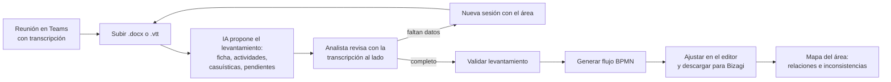
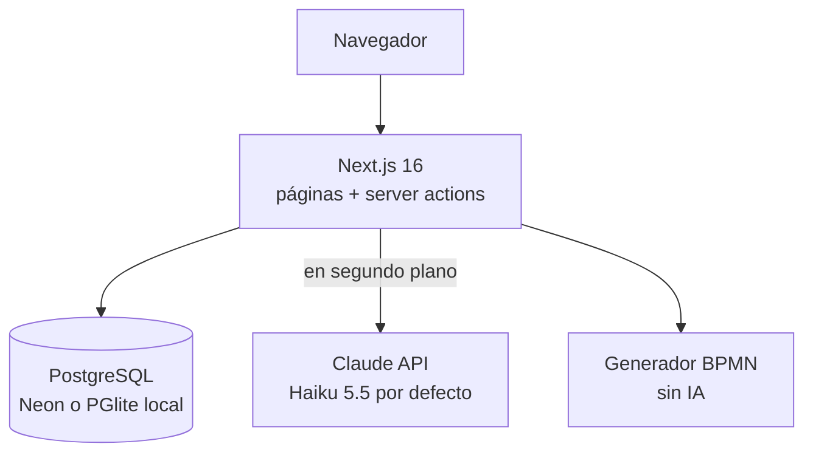

# Mapeo · Arquitectura

Plataforma web para levantar procesos a partir de reuniones de Microsoft Teams, modelarlos en BPMN 2.0 e integrar el mapa de cada área. Inspirada en herramientas como Bizagi, pero centrada en el paso que ellas no resuelven: pasar de una conversación con un área a un flujo documentado y validado.

Este documento describe lo que está construido. La guía para usuarios está en [GUIA.md](GUIA.md).

---

## 1. Recorrido del producto

Cada proceso pasa por tres pasos que la interfaz muestra siempre: **Levantar → Modelar → Integrar**. Cada artefacto tiene estado: `Borrador IA → En revisión → Validado`.

### Conceptos

- **Área**: agrupa procesos (p. ej. Gestión Financiera).
- **Proceso**: tiene código (`P-FIN-01`), sesiones, una ficha viva versionada y un flujo BPMN versionado.
- **Sesión**: una reunión de levantamiento con su transcripción, dividida en segmentos (hablante, minuto, texto).
- **Ficha viva**: el levantamiento acumulado del proceso. Cada sesión procesada crea una versión nueva que integra lo dicho en la sesión con lo que ya se sabía.
- **Flujo levantado vs. flujo modelado**: el levantamiento es lo que el área dijo, con citas y marcas de certeza; el flujo modelado es su traducción a BPMN 2.0.

## 2. Reglas de levantamiento

Viven en `src/lib/ia/nucleo.ts` y se anteponen a toda llamada a la IA:

1. No inventar: cada dato es *confirmado*, *inferido* o *pendiente*.
2. Citar la fuente: sesión y segmento exactos de la transcripción.
3. No quedarse en el camino feliz: variantes, errores, rechazos, controles.
4. Separar lo formal de lo real: Excel locales, chats, correos, controles paralelos.
5. Mostrar las contradicciones con las citas de cada versión.
6. Detectar errores de transcripción con el glosario del área ("efe ciento diez" → F110).
7. La IA propone; una persona decide.

## 3. Módulos

| Módulo | Qué hace | Dónde está |
|---|---|---|
| Procesos por área | Inventario de áreas y procesos con su estado | `src/app/page.tsx` |
| Subir transcripción | Recibe .docx, .vtt o .txt de Teams; crea área, proceso y sesión | `src/app/nuevo`, `src/lib/transcripcion` |
| Levantamiento con IA | Extrae ficha, actividades, casuísticas, diagnóstico y pendientes | `src/lib/ia/levantamiento.ts`, `src/lib/levantamiento` |
| Revisión | Aceptar, rechazar o corregir cada dato con la transcripción al lado | `src/components/levantamiento/revision.tsx` |
| Flujo modelado | Genera BPMN 2.0 sin IA, editor bpmn-js, descarga .bpmn y .svg | `src/lib/bpmn`, `src/app/procesos/[codigo]/flujo` |
| Mapa del área | Relaciones e inconsistencias entre procesos (IA), matrices de roles y sistemas | `src/lib/ia/mapa.ts`, `src/lib/mapa`, `src/app/areas` |

## 4. Arquitectura técnica

| Capa | Elección | Por qué |
|---|---|---|
| Framework | Next.js 16 (App Router, Cache Components) + TypeScript | UI y servidor en un proyecto; despliegue directo en Vercel |
| Estilos | Tailwind 4 con los tokens del sistema de diseño en `src/app/globals.css` | Cambiar de marca es cambiar variables |
| Base de datos | PostgreSQL con Drizzle ORM. Neon en la nube; PGlite embebido en local | Relacional y portable a Azure Database for PostgreSQL |
| IA | Claude por la API de Anthropic con salidas estructuradas validadas con Zod | Lo que no cumple el esquema no entra a la base |
| Modelo | `claude-haiku-5-5` por defecto; se cambia con `MAPEO_MODELO_IA` | El piloto prioriza costo; Sonnet u Opus dan más calidad |
| BPMN | Generador propio (texto XML) + bpmn-js para ver y editar | Determinístico, gratis e importable en Bizagi Modeler |
| Mapa | React Flow | Diagrama interactivo de procesos y relaciones |

### Pipeline de IA

| Etapa | Entrada | Salida | Archivo |
|---|---|---|---|
| Leer transcripción | .docx / .vtt / .txt de Teams | Segmentos (hablante, minuto, texto) | `src/lib/transcripcion/leer.ts` |
| Extraer levantamiento | Segmentos + glosario + ficha anterior | Ficha completa con citas y certezas | `src/lib/ia/levantamiento.ts` |
| Generar BPMN | Levantamiento sin lo rechazado | BPMN 2.0 con diagrama | `src/lib/bpmn/generar.ts` |
| Integrar área | Levantamientos del área | Relaciones, inconsistencias, roles equivalentes | `src/lib/ia/mapa.ts` |

Todas las llamadas pasan por `src/lib/ia/cliente.ts`: usa salidas estructuradas y, si la API rechaza el esquema, reintenta pidiendo JSON y lo valida con el mismo esquema Zod.

El levantamiento corre después de responder la petición (`after()` de Next) para no bloquear la pantalla; la página consulta el estado cada 10 segundos. Cada corrida queda en la tabla `ejecucion_ia` con modelo, tokens y duración.

### Reglas del BPMN generado

- Un carril por responsable, en orden de aparición.
- Una tarea por actividad (tarea de usuario si tiene sistema).
- Una compuerta exclusiva tras cada actividad con casuísticas o variantes (secuencias como `4-A1`); la rama por defecto es "Normal".
- Evento de inicio con el disparador y de fin con el hito de cierre de la ficha.
- Lo que la persona rechazó en la revisión no entra al diagrama.

### Modelo de datos

`area`, `usuario`, `membresia`, `glosario`, `proceso`, `sesion`, `transcripcion`, `segmento`, `ficha_version` (la ficha viva, en JSON), `modelo_bpmn`, `relacion_proceso`, `mapa_area`, `ejecucion_ia`, `auditoria`. Esquema completo en `src/db/schema.ts`; migraciones en `drizzle/`.

### Seguridad del piloto

- Ingreso simulado: toda la app pide usuario y contraseña (por defecto `prueba` / `prueba`, configurables con `MAPEO_USUARIO` y `MAPEO_CLAVE`). La sesión es una cookie `httpOnly` firmada con HMAC que dura 8 horas; `src/proxy.ts` la revisa en cada página y en la API. Es una simulación: el ingreso real de Comfama será con Microsoft Entra ID (sección 5).
- Además, toda acción que crea datos o gasta API (subir transcripción, procesar con IA, integrar el área) exige la clave del piloto (`MAPEO_CLAVE_PILOTO`).
- Las claves viven solo en variables de entorno; `/api/estado` informa si están configuradas sin mostrarlas.
- Las transcripciones contienen datos personales de colaboradores: en un despliegue real aplica la política de tratamiento de datos de la organización (en Colombia, Ley 1581 de 2012).

## 5. Integración con Microsoft 365

El piloto corre en Vercel. Estas son las rutas para llevarlo al entorno Microsoft, de menor a mayor esfuerzo:

| Opción | Qué es | Qué requiere de TI |
|---|---|---|
| A. Login con Entra ID | Inicio de sesión con la cuenta corporativa (Auth.js con proveedor Microsoft Entra ID) | Registrar la aplicación y asignar usuarios |
| B. Pestaña en Teams | Mapeo como pestaña personal o de canal, con inicio de sesión único | Publicar la app en el catálogo de la organización |
| C. Transcripciones desde Teams | Leer reuniones y transcripciones con Microsoft Graph en lugar de subir archivos | Consentimiento para `OnlineMeetings.Read` y `OnlineMeetingTranscript.Read.All` |
| D. Entregables en SharePoint | Guardar el .bpmn y la ficha en una biblioteca del área | Permiso `Sites.Selected` sobre un sitio |
| E. Datos e IA en Azure | Azure Database for PostgreSQL y Claude por Microsoft Foundry | Suscripción de Azure |
| F. Todo en Azure | Mover la app a Azure App Service o Static Web Apps | Suscripción y DevOps |

El código no depende de servicios exclusivos de Vercel: la base se cambia con `DATABASE_URL` y el cliente de IA está en un solo archivo (`src/lib/ia/cliente.ts`).

## 6. Estado y siguientes pasos

Hecho en el piloto: subida de transcripciones, levantamiento con IA multi-sesión, revisión, BPMN con editor y exportación, mapa del área.

Siguiente: login con Entra ID (opción A), lectura directa de transcripciones de Teams (C), exportación de la ficha a Word con la plantilla corporativa, línea base de productividad (FTE) y diseño TO-BE.
