# Mapeo: guía paso a paso

Esta guía explica, sin lenguaje técnico, qué es Mapeo, cómo se construyó y cómo se usa. Al final está lo necesario para que otro equipo lo instale.

---

## 1. Qué problema resuelve

Levantar un proceso con un área suele tomar varias reuniones. Alguien toma notas, después arma una ficha, una tabla de actividades y un diagrama en Bizagi. Ese trabajo de pasar de la conversación al documento es lento y depende de la memoria de quien levantó el proceso.

Mapeo hace ese paso con ayuda de la inteligencia artificial:

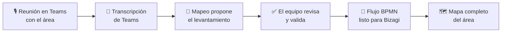

La IA nunca decide sola: propone, marca qué tan segura está de cada dato y muestra en qué minuto de la reunión se dijo. Una persona acepta, corrige o rechaza.

---

## 2. Cómo se construyó

El proyecto se hizo en cinco etapas. Cada una dejó algo funcionando antes de pasar a la siguiente.

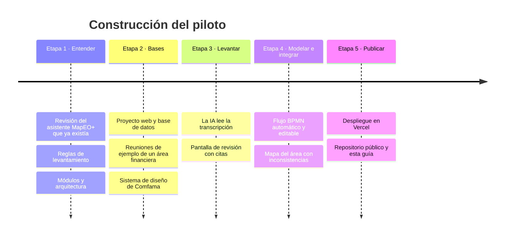

### Etapa 1 · Entender lo que ya existía

El equipo de Excelencia Operativa ya tenía un asistente en Claude, **MapEO+**, que entrevistaba a una persona para levantar un proceso. De él salieron las **reglas que Mapeo respeta siempre**:

| Regla | Qué significa en la práctica |
|---|---|
| No inventar | Si nadie dijo el dueño del proceso, el campo queda "pendiente", no se adivina |
| Citar la fuente | Cada dato lleva el minuto de la reunión donde se dijo |
| No quedarse en el camino feliz | Se buscan las excepciones: qué pasa cuando falta un dato, cuando hay un rechazo |
| Lo formal vs. lo real | Se registran los Excel propios, los grupos de WhatsApp, los correos de recordatorio |
| Mostrar las contradicciones | Si dos personas dicen cosas distintas, se muestran las dos |
| La IA propone, la persona decide | Nada queda validado sin aprobación humana |

También se vio que el uso real no era una entrevista con el asistente, sino **procesar la transcripción de una reunión grupal**. Por eso Mapeo parte de la transcripción de Teams.

### Etapa 2 · Las bases

- Se creó la aplicación web y su base de datos.
- Se aplicó el **sistema de diseño de Comfama**: colores, letra Roboto, íconos y logo.
- Se escribieron **cinco reuniones de ejemplo**, inventadas, de un área financiera de una caja de compensación: causación y pago a proveedores (dos sesiones), conciliación bancaria, recaudo de aportes del 4 % y cierre contable mensual.

Las reuniones de ejemplo traen trampas a propósito para comprobar que la IA no se equivoca:

- personas que se contradicen ("las aprobaciones las firma la jefe" / "no, las firma el director");
- errores típicos de la transcripción de Teams ("efe ciento diez" en vez de F110, la transacción de pagos de SAP);
- datos que nadie dijo y que la IA no debe inventar;
- inconsistencias entre procesos (un área dice que entrega el día 5 y la otra que lo necesita el día 3).

Para cada reunión quedó escrito qué debería encontrar la IA, para poder medirla.

### Etapa 3 · Levantar con IA

Cuando se sube una transcripción, Mapeo la divide en intervenciones (quién habló y en qué minuto) y se la entrega a Claude junto con las reglas y un glosario del área. Claude devuelve:

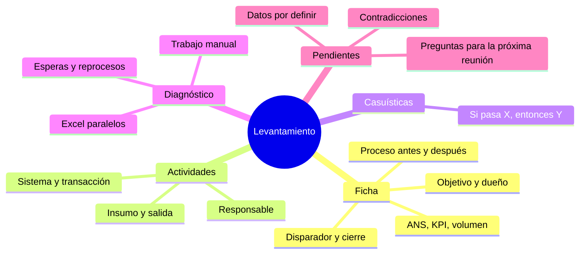

Si el proceso tiene varias reuniones, la segunda **no empieza de cero**: Claude recibe lo que ya se sabía, agrega lo nuevo, corrige lo que se aclaró y marca como resueltas las dudas que se cerraron. A eso se le llama la **ficha viva**.

### Etapa 4 · Modelar e integrar

- **Flujo BPMN**: Mapeo dibuja el diagrama con reglas fijas, sin IA: un carril por cada responsable, una caja por actividad y un rombo de decisión por cada casuística. Así el resultado es siempre el mismo y no cuesta nada. El diagrama se puede ajustar a mano y se descarga en formato `.bpmn`, que Bizagi Modeler importa.
- **Mapa del área**: con dos o más procesos levantados, Claude cruza todo y encuentra qué le entrega un proceso a otro, roles con nombres distintos que son la misma persona, actividades que dos equipos hacen por duplicado, plazos que no cuadran y salidas que nadie recibe.

### Etapa 5 · Publicar

- La plataforma quedó en internet en Vercel.
- Para controlar el gasto, la IA usa **Claude Haiku 5.5**, el modelo más económico, y toda acción que gasta créditos pide la **clave del piloto**.
- El código quedó en un repositorio público de GitHub, sin claves ni datos reales, para que otro equipo pueda instalarlo.

---

## 3. Cómo se usa

**Para entrar**, abre la plataforma e ingresa con el usuario `prueba` y la contraseña `prueba`. Es un ingreso simulado con los colores y el logo de Comfama; la sesión dura 8 horas y el botón **Salir**, arriba a la derecha, la cierra.

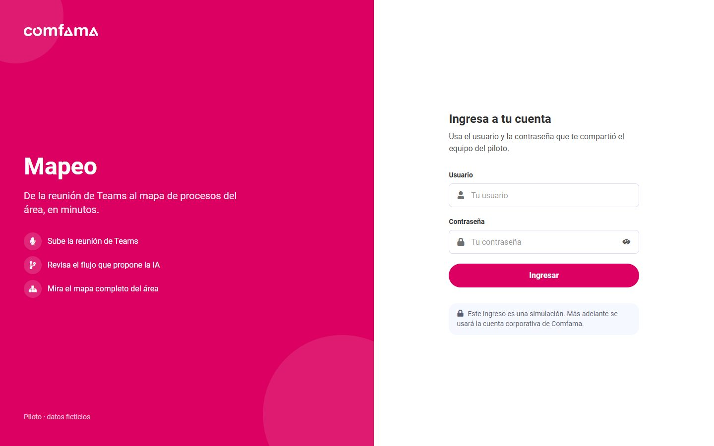

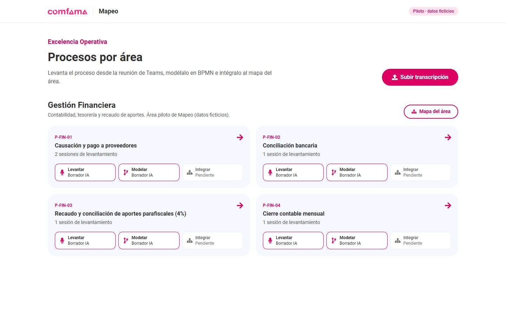

### Paso 1 · Grabar y transcribir la reunión en Teams

En la reunión con el área, activa la **transcripción** (en Teams: *Más acciones → Grabar y transcribir → Iniciar transcripción*). Al terminar, en el chat de la reunión ve a **Resumen → Transcripción → Descargar** y elige **.docx** o **.vtt**.

### Paso 2 · Subir la transcripción

En Mapeo, botón **Subir transcripción**.

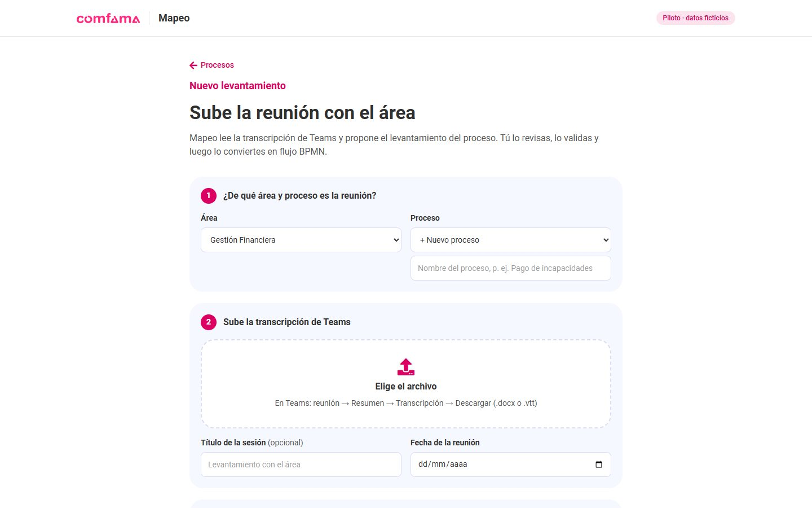

1. Elige el **área** y el **proceso**. Si es nuevo, escribe su nombre: Mapeo le asigna un código (por ejemplo `P-FIN-05`).
2. Sube el archivo de Teams.
3. Deja marcado **Procesar con IA apenas se suba**, escribe la **clave del piloto** y pulsa **Subir transcripción**.

Si el proceso ya existía, la reunión se agrega como una **sesión nueva** del mismo proceso.

### Paso 3 · Esperar el levantamiento

La IA tarda entre uno y tres minutos. La página se actualiza sola.

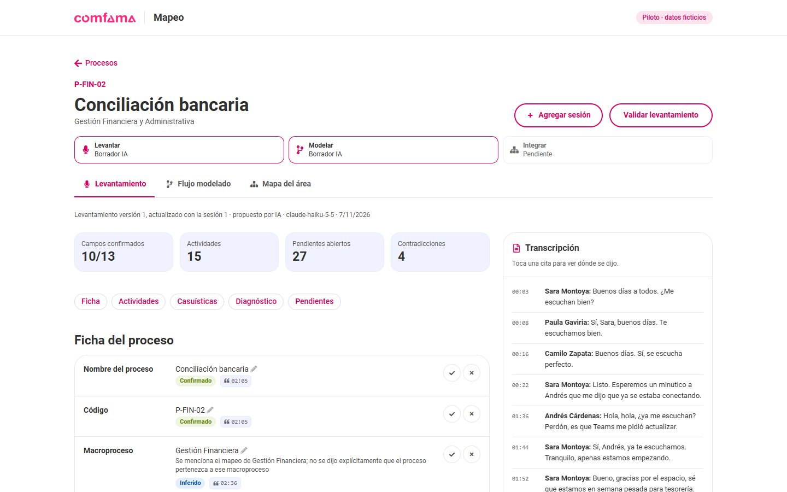

Arriba siempre se ven los tres pasos del proceso: **Levantar**, **Modelar** e **Integrar**, con su estado.

### Paso 4 · Revisar el levantamiento

La pantalla de revisión tiene dos columnas: a la izquierda lo que propuso la IA y a la derecha la transcripción.

| Lo que ves | Qué significa | Qué puedes hacer |
|---|---|---|
| Etiqueta verde **Confirmado** | Alguien lo dijo claramente | Aceptar ✓ |
| Etiqueta azul **Inferido** | La IA lo dedujo; explica por qué | Aceptar o corregir |
| Etiqueta amarilla **Pendiente** | Nadie lo dijo | Preguntarlo en la próxima reunión |
| Botón con minuto, p. ej. **12:34** | Dónde se dijo en la reunión | Tócalo: la transcripción salta a esa frase |
| Lápiz ✏️ | Corregir el texto | Escribe y pulsa Enter |
| ✓ y ✗ | Aceptar o rechazar el dato | Lo rechazado no pasa al diagrama |

En **Pendientes y hallazgos** están las contradicciones y las preguntas para la siguiente reunión. Marca la casilla cuando se resuelvan.

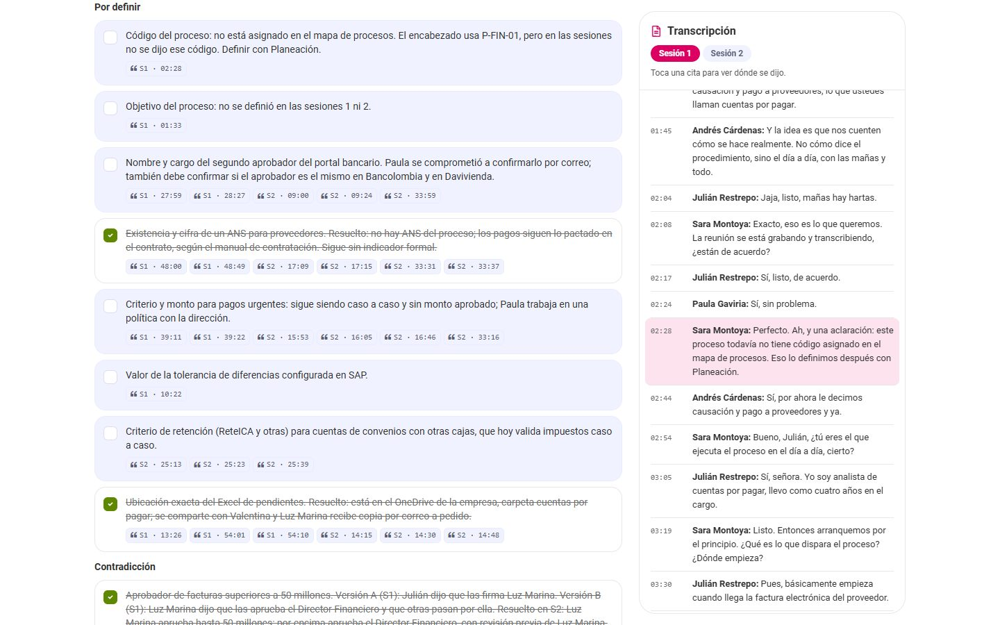

Cuando todo esté bien, pulsa **Validar levantamiento**.

### Paso 5 · Generar el flujo

Pestaña **Flujo modelado → Generar flujo BPMN**.

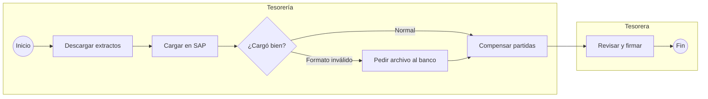

*Ejemplo simplificado: cada carril es un responsable y cada rombo una casuística.*

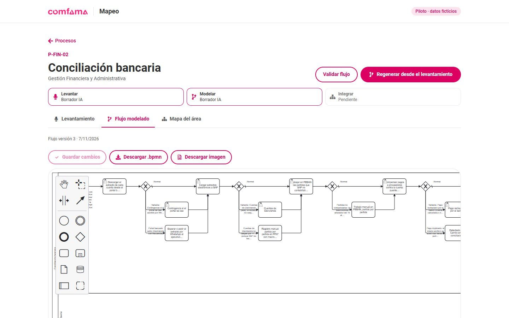

- Mueve, agrega o renombra elementos con la paleta de la izquierda y pulsa **Guardar cambios**.
- **Descargar .bpmn** para abrirlo en Bizagi Modeler (*Archivo → Importar → BPMN*).
- **Descargar imagen** para presentaciones.
- **Validar flujo** cuando esté listo.

### Paso 6 · Ver el mapa del área

Pestaña **Mapa del área** (o el botón del área en la página de inicio).

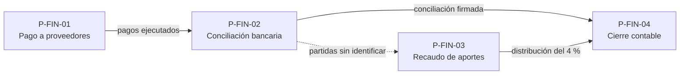

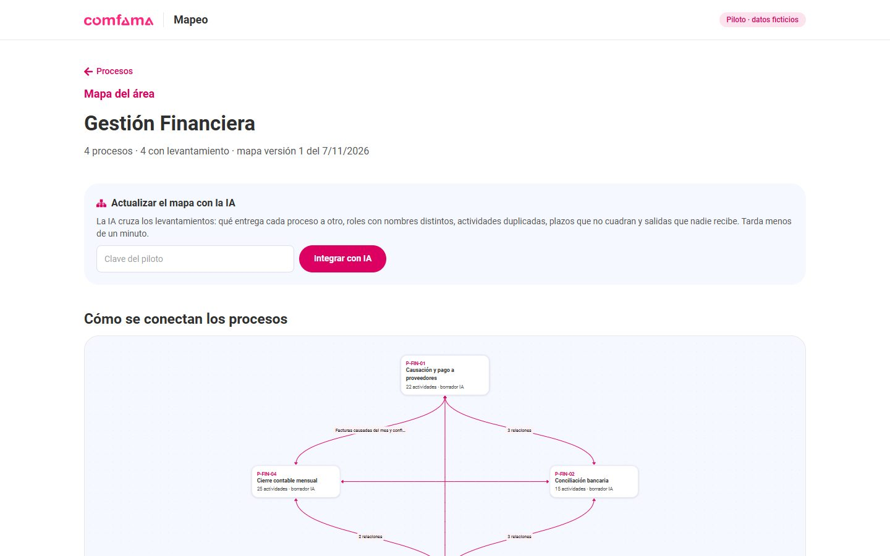

Con la clave del piloto, **Integrar con IA** dibuja estas conexiones (línea continua: se dijo en las reuniones; punteada: la IA lo dedujo) y lista las inconsistencias entre procesos. Debajo hay dos tablas: quién participa en qué proceso y qué sistemas usa cada uno.

### En el celular

Todas las pantallas se adaptan al celular: se puede revisar un levantamiento, ver el flujo y descargarlo. Para editar el diagrama conviene un computador.

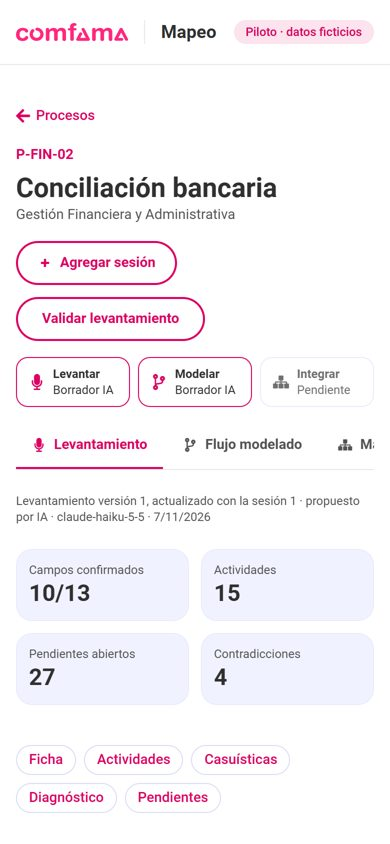

### Resultados con las reuniones de ejemplo

Se procesaron las cinco reuniones de ejemplo con Claude Haiku 5.5 y se compararon con lo que la IA debía encontrar:

| Prueba | Esperado | Encontrado |
|---|---|---|
| Contradicciones en la conciliación bancaria | 3 | 3, más una válida adicional |
| Errores de transcripción en la conciliación bancaria | 6 | 5 (se agregó "Banco Colombia" al glosario) |
| Datos no dichos que deben quedar pendientes | 8 | 8 |
| Segunda sesión de pago a proveedores | Resolver 2 contradicciones y dejar 1 abierta | Igual |
| Inconsistencias entre procesos del área | 4 sembradas | Las 4, más 9 adicionales razonables |

Cada reunión tardó entre 1,5 y 3 minutos y costó cerca de un centavo de dólar.

---

## 4. Cuánto cuesta usarlo

- **Plataforma (Vercel y base de datos Neon):** los planes gratuitos alcanzan para el piloto.
- **IA:** Claude Haiku 5.5 cobra por volumen de texto. Una reunión de una hora cuesta del orden de un centavo de dólar; integrar un área, menos. Si se necesita más calidad se puede cambiar a Claude Sonnet o Opus, que cuestan más.
- **Generar el flujo BPMN:** gratis, no usa IA.

---

## 5. Seguridad del piloto

- Para entrar se pide usuario y contraseña (`prueba` / `prueba` en el piloto). Además, **todo lo que crea datos o gasta créditos pide la clave del piloto**. Los datos de ejemplo son inventados.
- Las claves (de Claude, de la base de datos y del piloto) están guardadas en Vercel como secretas y no aparecen en el código ni en el repositorio.
- La dirección `/api/estado` dice si todo está configurado sin mostrar ninguna clave.
- Para usar reuniones reales hace falta, antes, el inicio de sesión con las cuentas de Microsoft de la organización y la aprobación de Seguridad de la Información para el tratamiento de datos personales.

---

## 6. Para instalarlo en otra organización

El código está en GitHub: **github.com/Kulttia/mapeo**. Quien lo instale necesita:

1. Una cuenta de Vercel (o Azure) y una base de datos PostgreSQL.
2. Una clave de la API de Claude (console.anthropic.com).
3. Seguir el [README](../README.md): clonar, configurar tres variables y desplegar.

Las opciones para integrarlo con Microsoft 365 (inicio de sesión corporativo, pestaña en Teams, lectura directa de transcripciones, SharePoint y Azure) están en la [arquitectura](ARQUITECTURA.md#5-integración-con-microsoft-365).

---

## 7. Qué sigue

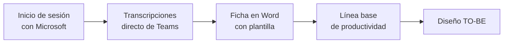
